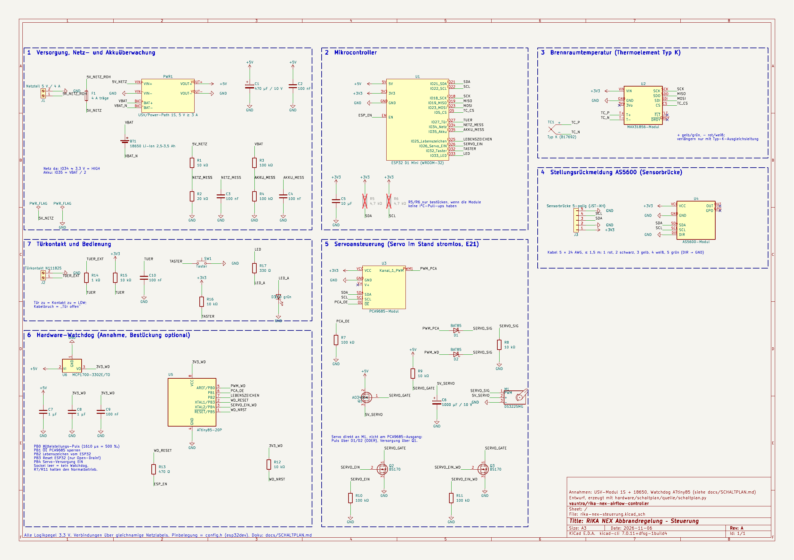

# Schaltplan der Steuerung

Stand 06.11.2026, Revision A (Entwurf). KiCad-Projekt in [`hardware/schaltplan/`](../hardware/schaltplan/):

| Datei | Inhalt |
|---|---|
| `rika-nex-steuerung.kicad_pro` / `.kicad_sch` | KiCad-Projekt und Schaltplan (A3, ein Blatt). Format KiCad 7, öffnet in KiCad 8 und 9 |
| `rika-nex-steuerung.kicad_sym`, `sym-lib-table` | Projektbibliothek `rika_nex` (Module und die verwendeten Standardsymbole) |
| `rika-nex-steuerung.pdf` / `.png` | Export zum Ansehen und Drucken |
| `quelle/schaltplan.py` | Generator: `python3 hardware/schaltplan/quelle/schaltplan.py` erzeugt den Schaltplan neu (braucht die KiCad-Symbolbibliothek unter `/usr/share/kicad/symbols`) |

Pinbelegung wie in `firmware/rika-nex-controller/include/config.h` (Zweig `esp32dev`) und
[`VERKABELUNG.md`](VERKABELUNG.md). Die Verbindungen laufen über gleichnamige Netzlabels.
Der Aufbau ist modular gedacht (Lochraster-Trägerplatine mit Steckleisten für die fertigen Module).

## Blöcke

1. **Versorgung:** Netzteil 5 V / 4 A an J1, Sicherung F1, USV-/Power-Path-Modul PWR1 mit 18650-Zelle BT1.
   Ausgang `+5V` versorgt ESP32-Board, Servo und Watchdog. Netzerkennung: Teiler R1/R2 (10k/20k) **vor** PWR1 auf
   IO34. Akkuspannung: Teiler R3/R4 (100k/100k) auf IO35. C1 470 µF puffert die Servo-Spitzen am Modulausgang.
2. **Mikrocontroller:** ESP32 D1 Mini (WROOM-32, E20). Der 3,3-V-Regler des Boards versorgt alle Module.
   R5/R6 (I²C-Pull-ups) nur bestücken, wenn PCA9685- und AS5600-Modul keine eigenen haben.
3. **Brennraumtemperatur:** MAX31856-Modul am SPI-Bus (CS = IO5), Original-Thermoelement Typ K an T+/T−.
4. **Stellungsrückmeldung:** Stecker J3 (JST-XH, 5-polig) zur Sensorbrücke, AS5600 mit DIR fest auf GND.
5. **Servoansteuerung:**
   - **Q1 (P-MOSFET AO3401A) schaltet die Servoversorgung**, angesteuert über Q2 (BS170) von IO26. Damit ist der
     Servo im Stand wirklich stromlos (E21), auch der Ruhestrom der Servo-Elektronik entfällt. R10 hält Q2 beim
     Booten aus, der Servo zuckt beim Einschalten nicht.
   - Der Servo hängt **direkt an M1** und nicht mehr am Kanal-1-Stecker des PCA9685. Der Puls kommt über die
     Dioden-ODER-Schaltung D1/D2 (BAT85) mit R8 als Pull-down: entweder vom PCA9685 (Normalbetrieb) oder vom
     Watchdog. Pegel am Servo ca. 3,0 V, das reicht für den DS3225MG. V+ am PCA9685 bleibt frei.
   - C6 (1000 µF) direkt am Servo-Anschluss.
6. **Hardware-Watchdog** (siehe Annahmen): ATtiny85 im DIP-Sockel mit eigenem 3,3-V-Regler U6 (MCP1700),
   damit er auch bei einem Fehler im 3,3-V-Zweig des ESP32-Boards weiterläuft.
7. **Türkontakt und Bedienung:** Türkontakt an J2 mit externem Pull-up R15, Schutzwiderstand R14 und C10 gegen
   Störungen auf der langen Leitung. Taster SW1 (IO32) und Status-LED D3 (IO33) für die lokale Bedienung.

## Neue GPIOs gegenüber `VERKABELUNG.md`

| ESP32 | Funktion | Netz |
|---|---|---|
| IO25 | Lebenszeichen an den Watchdog (Pegelwechsel mindestens alle 0,5 s) | `LEBENSZEICHEN` |
| IO26 | Servoversorgung EIN (HIGH = Servo hat Strom) | `SERVO_EIN` |
| IO32 | Taster nach GND | `TASTER` |
| IO33 | Status-LED (HIGH = an) | `LED` |

In `config.h` als `PIN_HEARTBEAT`, `PIN_SERVO_EN`, `PIN_BUTTON`, `PIN_LED` eingetragen. Die Firmware nutzt sie noch nicht.

## Watchdog-Funktion (Vorschlag)

| ATtiny85 | Funktion |
|---|---|
| PB2 (Pin 7) | Lebenszeichen vom ESP32 (IO25) |
| PB0 (Pin 5) | Ersatz-Servopuls über D2 |
| PB1 (Pin 6) | `~OE` des PCA9685: HIGH sperrt dessen Ausgänge (R7 hält sie sonst frei) |
| PB4 (Pin 3) | Servoversorgung EIN über Q3, parallel zu Q2 |
| PB3 (Pin 2) | Reset des ESP32 über R13 auf EN, **nur als Open-Drain** betreiben (LOW oder Eingang) |

Ablauf, wenn 5 s kein Pegelwechsel kommt: PCA9685 sperren, Servo einschalten, 2 s lang 50-Hz-Pulse mit
1610 µs senden (Mitte zwischen `AIR_US_AT_0` = 2360 µs und `AIR_US_AT_1000` = 860 µs, also 500 ‰), Servo wieder
ausschalten, dann den ESP32 für 100 ms zurücksetzen. Kommt das Lebenszeichen wieder, gibt der Watchdog den PCA9685
frei. Bleibt der Sockel leer, halten R7 und R11 den Normalbetrieb, die Schaltung funktioniert dann ohne Watchdog.
Der ATtiny wird außerhalb der Schaltung programmiert (Sockel). Die Watchdog-Firmware gibt es noch nicht.

## Annahmen (offene Entscheidungen, bitte prüfen)

- **Akku oder Mini-USV:** Gezeichnet ist ein 1S-USV-/Power-Path-Modul (5 V Ein, 5 V Aus ≥ 3 A unterbrechungsfrei)
  mit einer 18650-Zelle und Schutzschaltung. Eine fertige Mini-DC-USV passt in dieselbe Stelle (PWR1). Wenn ihr
  Akku nicht zugänglich ist, entfallen BT1 und der Akkuteiler R3/R4/C4, die Netzerkennung bleibt.
- **Watchdog:** ATtiny85 wie oben. Alternative wäre ein reiner Watchdog-IC (z. B. TPS3823), der nur den ESP32
  zurücksetzt, aber den Servo nicht selbst in die Mitte fahren kann. Der Projektplan verlangt das Anfahren der
  Mittelstellung, deshalb der kleine Controller.
- **Q1 als SOT-23** (AO3401A, 4 A, schaltet ab 2,5 V Gate-Spannung sicher). Auf Lochraster mit SOT-23-Adapter.
- Footprints sind für einen späteren Platinenentwurf vorbelegt (THT, wo möglich), für die Module noch nicht.

## Prüfung

- Netzliste mit `kicad-cli` (KiCad 7.0.11) exportiert und geprüft: alle Netze haben mindestens zwei Anschlüsse,
  offen sind nur die gewollt freien Pins (MAX31856 3Vo/FLT/DRDY, PCA9685 V+, AS5600 OUT/GPO, mit No-Connect markiert).
- Der elektrische Regelcheck (ERC) ist mit `kicad-cli` erst ab KiCad 8 möglich und läuft deshalb noch nicht.
  In KiCad: *Prüfen → Elektrische Regeln prüfen*.

## Änderungen an der Verkabelung

- Servo nicht mehr am PCA9685-Kanal 1 einstecken, sondern an M1 (Signal über D1, Versorgung über Q1).
  Das betrifft erst den ESP32-Aufbau; der Testaufbau mit dem D1 Mini bleibt wie in `VERKABELUNG.md`.
- Die Firmware muss für E21 zusätzlich IO26 vor jeder Fahrt einschalten und nach `SERVO_MOVE_MS` wieder ausschalten.
